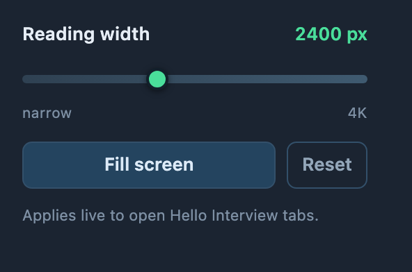
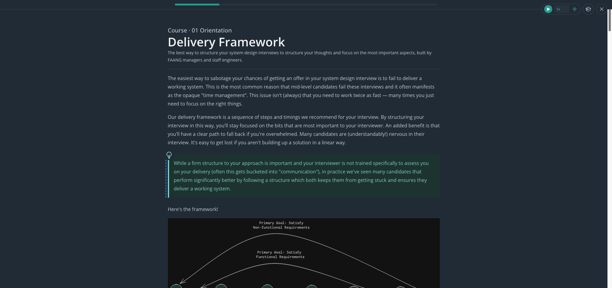
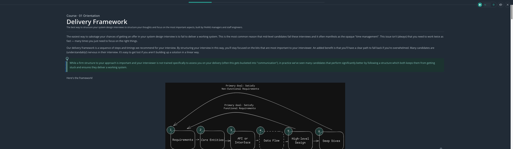
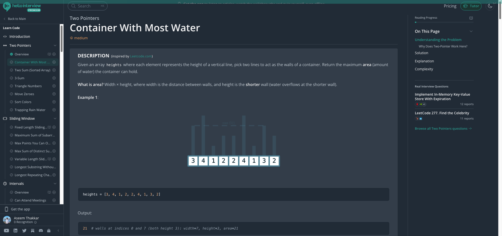

# Hello Interview — Wider Reading (v3)

A tiny, dependency-free Edge/Chrome extension that widens the reading pane on
[hellointerview.com](https://www.hellointerview.com) — including **Focus mode** —
with a width slider in the toolbar popup and keyboard shortcuts for narration.

## The knob

Click the extension icon (puzzle-piece menu → pin it first if you like), then:

- **Slider** — 900 → 4800 px, applied live to every open Hello Interview tab.
- **Fill screen** — no cap at all (`100%`), edge to edge.
- **Reset** — back to the default `min(100%, 2400px)`.
- **Narration shortcuts** — press **Space** or **K** to play/pause, and
  **Shift+<** / **Shift+>** to decrease/increase playback speed in 0.25x steps
  (from 1x to 2x). Use **K without Command** so Hello Interview's **Cmd+K**
  search shortcut remains available. Shortcuts are ignored while typing in a
  form field and operate the narration controls, not the lesson video. They
  also work in Reading Mode.

The value is stored in `chrome.storage.sync`, so it survives restarts and
follows your Edge profile.

## Focus mode, before → after

| Before (stock 896 px) | After (2400 px cap on a 3261 px screen) |
| --- | --- |
|  |  |

Normal lesson pages widen too, with the "On This Page" rail pinned at 340 px:

## Why the old CSS knob did nothing

1. **Focus mode uses a different container.** Normal pages use a 7-column
   `max-w-5xl` grid; Focus mode swaps in a single `max-w-4xl` (896 px) column.
   The old stylesheet only matched `max-w-5xl`, so Focus mode was untouched.
2. **The grid was capped by its parents.** It sits inside a `max-w-7xl`
   (1680 px) and `max-w-6xl` (1600 px) wrapper, so raising only the grid number
   could never get past 1680 px.

v2 removed the outer caps; v3 puts the width on a slider.

## Install / update

1. `edge://extensions` → **Developer mode** on.
2. **Load unpacked** → pick this folder:
   `~/Documents/deepseek-harness/default-workspace/hellointerview-wide`
   (already installed? just hit **Reload** on the card.)
3. Reload any open Hello Interview tab once, then click the toolbar icon.

The reload matters twice: manifest/CSS/JS changes aren't hot-swapped, and tabs
that were open before the extension loaded have no content script to talk to.

## Under the hood

- `content.css` — raises the three nested max-widths, handles Focus mode's
  `max-w-4xl` grid, and pins the side rail to 340 px. Width comes from
  `--hi-content-width`.
- `content.js` — reads `hiContentWidth` from storage, sets the CSS variable,
  listens for changes so the slider updates tabs live, and handles narration
  keyboard shortcuts.
- `popup.*` — the slider UI.

Advance tweak: `--hi-rail-width` in `content.css` changes the "On This Page"
rail width on normal lesson pages.

## Uninstall

`edge://extensions` → **Remove**.
